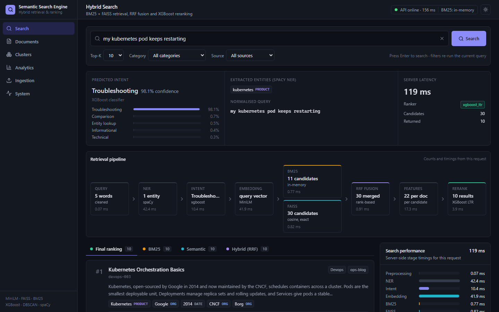
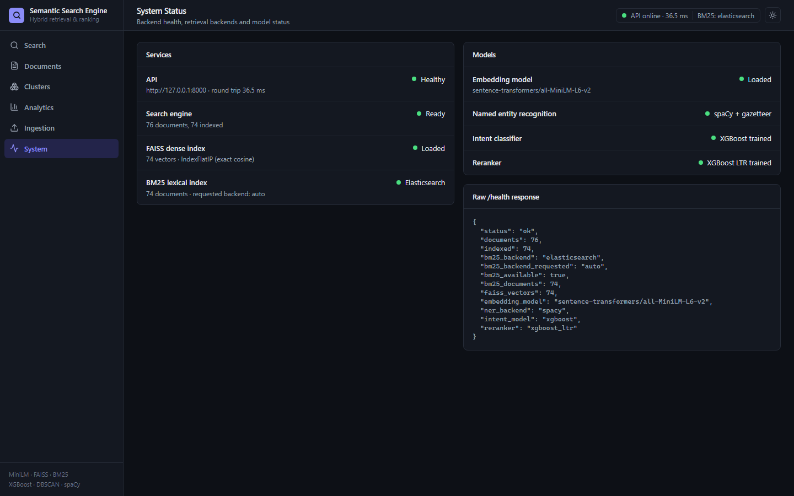
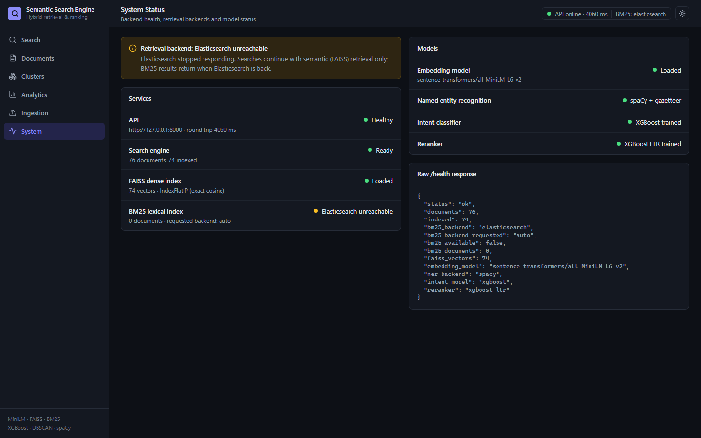
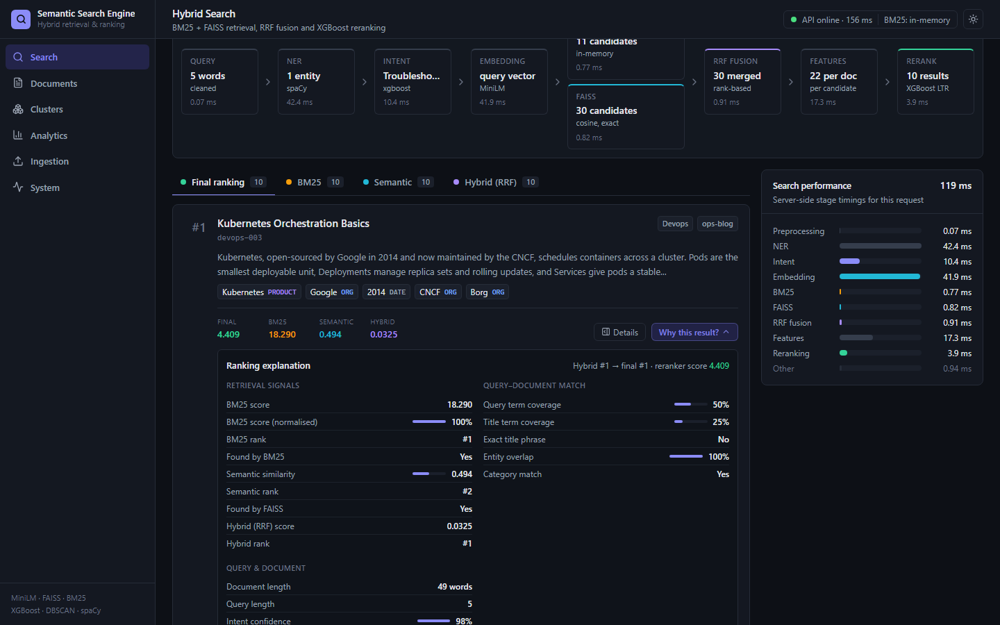
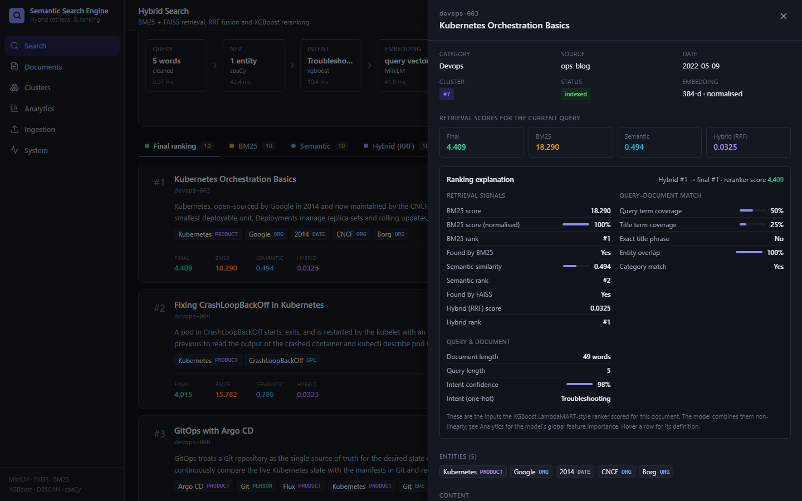
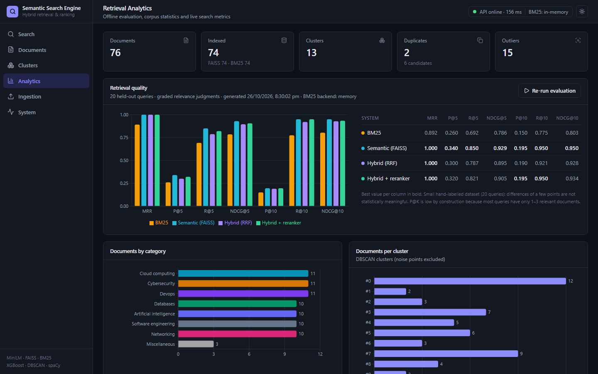
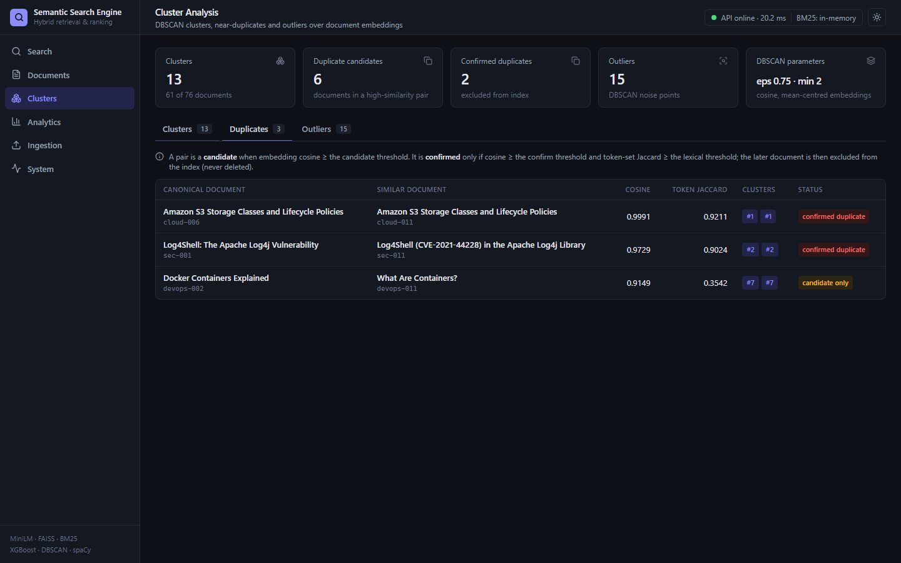
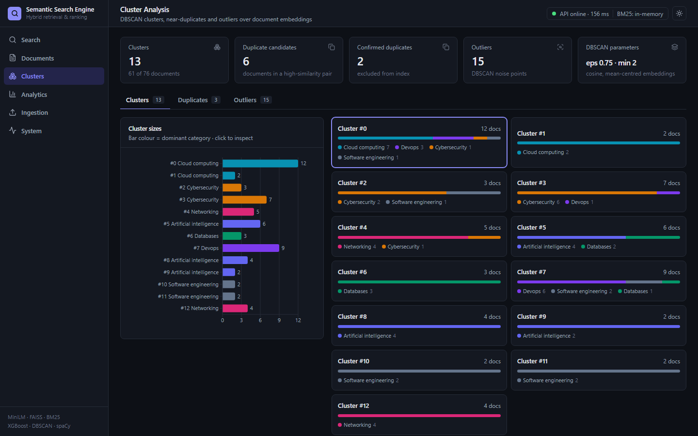
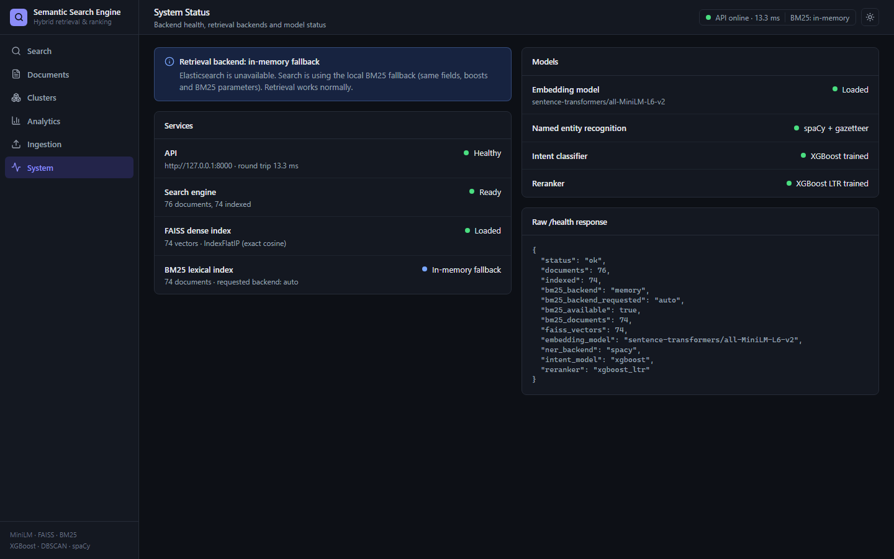

# Semantic Search & Ranking Engine

A hybrid document retrieval system that combines lexical BM25 (Elasticsearch), dense semantic
retrieval (Sentence-Transformers + FAISS), XGBoost query-intent classification, XGBoost
learning-to-rank, DBSCAN-based duplicate/outlier analysis and spaCy NER, served through FastAPI,
with a React dashboard that shows every stage of every query.



It is a portfolio / learning project sized to run on a laptop CPU. It ships with a small
hand-written corpus (77 records) and hand-labelled relevance judgments so the whole pipeline runs
and can be measured immediately. The ML models are trained on tiny synthetic datasets, so treat
the numbers as a demonstration that the pipeline can be measured, not as benchmark results.

**Demo:** a 3-minute interview walkthrough is in [docs/demo-guide.md](docs/demo-guide.md).

## 1. What this project demonstrates

A hybrid document retrieval system, end to end and with every intermediate result inspectable:

* **Lexical retrieval**: BM25 on Elasticsearch for exact terms, identifiers and error messages
  (`CVE-2021-44228`), with an in-memory BM25 fallback when Elasticsearch is not running.
* **Dense semantic retrieval**: pretrained MiniLM sentence embeddings in FAISS, for paraphrases
  ("stop attackers from guessing user passwords" → *credential stuffing / rate limiting*).
* **Rank fusion**: Reciprocal Rank Fusion, independent of incomparable score scales.
* **Learning to rank**: an XGBoost ranker over 22 named features, shown per result in the UI.
* **Query intent classification**: XGBoost over hand-crafted + TF-IDF features.
* **Named entity recognition**: spaCy plus a technology gazetteer, for documents and queries.
* **Data quality**: DBSCAN clustering, near-duplicate detection and outlier flagging at ingestion.
* **Evaluation**: P@K, R@K, MRR and NDCG@K comparing BM25, semantic, hybrid and hybrid + reranker.
* **Interactive dashboard**: React app with search, explanations, analytics, clusters,
  ingestion and system status.

### Implemented features

* JSON / JSONL ingestion with validation, cleaning, empty-document rejection and upserts
* spaCy NER on documents and queries; entities stored, indexed and used as a ranking feature
* MiniLM embeddings cached by content hash; FAISS exact-cosine index persisted to disk
* Elasticsearch BM25 (strict mapping, bulk indexing, category/source filters) with automatic
  in-memory fallback and graceful degradation to semantic-only if Elasticsearch fails mid-request
* Hybrid retrieval with RRF that keeps both raw scores and ranks per candidate
* XGBoost intent classifier (5 intents) with rule fallback when untrained
* XGBoost `rank:ndcg` reranker trained on judged queries disjoint from the evaluation queries
* DBSCAN cluster / duplicate-candidate / confirmed-duplicate / outlier analysis; confirmed
  duplicates are excluded from the index, nothing is deleted
* Offline evaluation script and API endpoint; live search latency statistics
* FastAPI with typed request/response models, CORS, structured JSON logging
* React dashboard (Search, Documents, Clusters, Analytics, Ingestion, System), CLI demo,
  Docker Compose (Elasticsearch + API + dashboard), GitHub Actions CI

## 2. Architecture

```
 INGESTION (POST /documents/ingest, scripts/build_index.py)
 ───────────────────────────────────────────────────────────
  JSON / JSONL ──► schema validation (Pydantic) ──► preprocessing (clean_text)
                                                     │  empty/short docs rejected
                         ┌───────────────────────────┴──────────────┐
                         ▼                                          ▼
                 spaCy NER + tech gazetteer             MiniLM embeddings (cached by content hash)
                         │                                          │
                         │                                          ▼
                         │                         DBSCAN (cosine, mean-centred) over all
                         │                           ├─ cluster_id
                         │                           ├─ outliers (noise)
                         │                           └─ duplicate candidates ─► cosine + Jaccard check
                         │                                                     └─► confirmed duplicates
                         ▼                                          ▼            (excluded from index)
                 Elasticsearch BM25 index  ◄──── indexable docs ────►  FAISS IndexFlatIP

 QUERY (POST /search)
 ───────────────────────────────────────────────────────────
  query ─► validate/clean ─► query NER ─► XGBoost intent ─► query embedding
                                                               │
                   ┌───────────────────────────────────────────┴─────┐
                   ▼                                                 ▼
          Elasticsearch BM25 (top 30)                       FAISS cosine (top 30)
                   └──────────────► Reciprocal Rank Fusion ◄─────────┘
                                          │  candidates keep both scores + ranks
                                          ▼
                              ranking feature extraction (22 features)
                                          ▼
                              XGBoost LambdaMART-style reranker (rank:ndcg)
                                          ▼
                           final results + scores + features + latency
```

### Repository layout

```
app/
  api/            FastAPI app and routes
  config/         Settings (environment variables)
  ingestion/      JSON/JSONL loading and validation
  preprocessing/  clean_text (for embeddings/NER) and tokenize (for BM25/features)
  nlp/            spaCy NER + technology gazetteer
  embeddings/     Sentence-Transformer encoder, embedding cache
  retrieval/      FAISS, Elasticsearch, in-memory BM25, hybrid RRF
  classification/ XGBoost intent classifier
  ranking/        feature extraction + XGBoost reranker
  clustering/     DBSCAN duplicate/outlier analysis
  evaluation/     P@K, R@K, MRR, NDCG@K and system comparison
  services/       SearchEngine orchestrator
  models/         Pydantic schemas (documents + API contracts)
data/sample/      corpus, intent training data, ranking-train qrels, evaluation qrels
data/processed/   generated: FAISS index, document store, embedding cache, models
scripts/          build_index, train_models, evaluate, demo_search, compare_bm25, dev
tests/unit/       fast tests (hashing embedder, mocked Elasticsearch)
tests/integration real model tests (+ optional live Elasticsearch)
docker/           API Dockerfile
frontend/         React dashboard (see "Dashboard" below)
docs/             demo guide and screenshots
.github/workflows CI
```

## 3. Technologies

| Concern | Choice |
|---|---|
| Language | Python 3.11 |
| Embeddings | Hugging Face / Sentence Transformers `all-MiniLM-L6-v2` (384-d, pretrained, not fine-tuned) |
| Dense index | FAISS `IndexFlatIP` on L2-normalised vectors (exact cosine) |
| Lexical | Elasticsearch 8 BM25; in-memory BM25 fallback |
| NER | spaCy `en_core_web_sm` + EntityRuler gazetteer |
| Intent | XGBoost multi-class on hand-crafted + TF-IDF features |
| Reranking | XGBoost `XGBRanker(objective="rank:ndcg")` |
| Clustering, TF-IDF, CV | scikit-learn (DBSCAN with cosine distance, TfidfVectorizer, StratifiedKFold) |
| API | FastAPI + Pydantic v2 |
| Dashboard | React 19, TypeScript, Vite, Tailwind CSS 4, Recharts, TanStack Query |
| Tests / CI | pytest, Vitest + Testing Library, Ruff, oxlint, GitHub Actions |

## 4. Retrieval pipeline

`SearchEngine.search(query, top_k)` (`app/services/search_service.py`):

1. Validate and clean the query (HTTP 422 for empty/oversized input, 400 if nothing searchable remains).
2. Query NER → `entities`.
3. Intent prediction → `intent {label, confidence, probabilities, source}`.
4. Embed the query once (reused by FAISS and by the features).
5. BM25 top-`CANDIDATE_K` and FAISS top-`CANDIDATE_K` (default 30), with optional `category`/`source` filters.
6. Reciprocal Rank Fusion → candidates carrying `bm25_score`, `bm25_rank`, `semantic_score`, `semantic_rank`, `hybrid_score`.
7. Ranking features for each candidate.
8. XGBoost reranking; return top-`k` with all scores, features, per-stage latency.

If Elasticsearch fails mid-request the engine logs the error, continues semantic-only and
reports `bm25_backend: "elasticsearch (unavailable: ...)"` in the response.

## 5. BM25 in this project

* **Elasticsearch** (`app/retrieval/elasticsearch_retriever.py`): strict mapping with `title`
  and `content` on the `english` analyzer (stemming happens *inside ES*, not in our
  preprocessing), `category`/`source` as keywords, entities as `{text, label}` objects, metadata
  as `flattened`. Query: `multi_match` `most_fields` over `title^2, content, entities.text`, with
  `term` filters. Bulk indexing via `helpers.bulk`. The client is injected, so unit tests use a mock.
* **In-memory fallback** (`app/retrieval/bm25_memory.py`): Okapi BM25 with Lucene defaults
  (k1=1.2, b=0.75) over the same three fields with the same boosts. Selected automatically when
  `BM25_BACKEND=auto` and ES does not answer a ping. Rankings are similar to ES but scores are
  not numerically identical because the analyzers differ.

### Elasticsearch verification (2026-10-27, Elasticsearch 8.15.3 via `docker compose`)

* `REQUIRE_ELASTICSEARCH=1 pytest tests/integration/test_elasticsearch_live.py` **passed**
  (index creation, bulk indexing, BM25 search, category filter, deletion), and the full backend
  suite passes with Elasticsearch running.
* With ES up, the API selects it automatically: `/health` reports `"bm25_backend":
  "elasticsearch"`, 74 documents are in the `documents` index (the 2 confirmed duplicates are
  excluded), and the System page shows BM25 → Elasticsearch.
* `python scripts/compare_bm25.py` (same 74 documents in both backends, top 5):

  | Query | Top-1 (in-memory / ES) | Overlap@5 | Notes |
  |---|---|---|---|
  | my kubernetes pod keeps restarting | devops-003 / **devops-004** | 4/5 | ES `english` analyzer stems *restarting → restart*, matching "restarted by the kubelet" in the CrashLoopBackOff article |
  | cloud security architecture | cloud-001 / cloud-001 | 4/5 | ES scores the title higher (*secure* and *security* share a stem) |
  | database query performance | db-007 / **db-001** | 5/5 | same five documents, top two swapped |
  | CVE-2021-44228 | sec-001 / sec-001 | 1 vs 2 hits | ES's `standard` analyzer on entity text splits the ID into `cve` / `2021` / `44228`, so "2021" also matches the Facebook-outage article |
  | security, category=networking | net-010 / net-010 | 1/1 | filter respected by both |

  Absolute scores are on a similar scale but not identical; neither backend was tuned to match
  the other.
* **Outage and recovery** (container stopped while the API kept running): the API stays up,
  `/health` reports `"bm25_available": false`, searches return HTTP 200 with semantic-only
  results (`bm25_backend: "elasticsearch (unavailable: ConnectionError)"`), and the System page
  shows an "Elasticsearch unreachable" warning. After the container restarted, the API picked
  Elasticsearch up again on its own within about 20 s (the client's dead-node backoff), without
  an API restart.

| Elasticsearch active | Elasticsearch stopped while the API runs |
|---|---|
|  |  |

## 6. Semantic retrieval

Documents are encoded as `"{title}. {content}"` with MiniLM, normalised, and cached in
`data/processed/embedding_cache.npz` keyed by `sha1(model_name + text)`, so restarts and
re-ingestion never re-encode unchanged text. FAISS `IndexFlatIP` over unit vectors returns cosine
similarities; a parallel id list maps FAISS positions back to `document_id`. Exact search is
appropriate for this corpus size; `IndexHNSWFlat` would be the swap for large corpora.

## 7. Hybrid retrieval

BM25 scores are unbounded and corpus-dependent; cosine lives in [-1, 1]. Adding them would let
one dominate, so fusion uses **Reciprocal Rank Fusion**:

```
RRF(d) = w_bm25 / (k + rank_bm25(d)) + w_sem / (k + rank_sem(d))      k = RRF_K = 60
```

A document returned by only one retriever gets only that term. Documents returned by both are
merged into a single candidate that keeps both raw scores and both ranks (tests cover BM25-only,
semantic-only, merged and duplicate-id cases).

## 8. XGBoost intent classification

`app/classification/intent.py`. Five intents: `informational`, `technical`, `entity_lookup`,
`troubleshooting`, `comparison`. Features: 14 hand-crafted signals (length, token count,
question words, `?`, keyword-cue ratios per intent, NER entity counts, capitalisation, digits)
concatenated with word uni/bi-gram TF-IDF, fed to `XGBClassifier(multi:softprob)`.

Trained on **125 hand-written queries** (`data/sample/intent_training.jsonl`). This is a
demonstration classifier: `scripts/train_models.py` prints the 5-fold cross-validated accuracy
(see *Evaluation*), which on such a small set has wide variance. If no model artifact exists and
auto-training is disabled, a keyword rule fallback answers with `source: "rule_fallback"` and
`confidence: 0.0`. The intent is fed to the reranker as one-hot features + confidence.

## 9. Reranking (learning to rank)

* **Features** (`app/ranking/features.py`, 22 total): `bm25_score`, `bm25_score_norm` (÷ max in
  candidate set), `bm25_rank`, `in_bm25`, `semantic_similarity` (exact cosine, computed for every
  candidate), `semantic_rank`, `in_semantic`, `hybrid_score`, `hybrid_rank`,
  `query_term_coverage`, `title_term_coverage`, `title_phrase_match`, `entity_overlap`,
  `category_match`, `doc_length_log`, `query_length`, intent one-hot ×5, `intent_confidence`.
  A rank missing from one retriever is encoded as `CANDIDATE_K + 1`.
* **Training data**: `data/sample/ranking_training_qrels.json` — 34 queries with graded
  judgments (2/1/0). For each query the real hybrid retriever produces candidates; each
  candidate becomes a row labelled with its judged grade (unjudged = 0); queries form groups.
* **Model**: `XGBRanker(objective="rank:ndcg")`.
* **Inference**: `rerank(candidates, features)` returns `final_score` (raw ranker margin — only
  meaningful relative to other results of the same query), original scores, the feature dict and
  rank position. Untrained → hybrid order with `ranker: "hybrid_fallback"`.
* **Leakage control**: evaluation queries (`evaluation_qrels.json`) are disjoint from training
  queries. Many target documents overlap, which is unavoidable with a 70-document corpus.

## 10. Data quality: DBSCAN, duplicates and outliers

`app/clustering/dbscan_analysis.py`, run over all accepted documents at every ingest. Clustering
uses mean-centred, re-normalised embeddings: MiniLM vectors share a large common component, so on
raw vectors DBSCAN either chains the whole technical corpus into one cluster or marks most of it
as noise. Duplicate checks use the raw cosine.

| Status | Rule |
|---|---|
| cluster member | DBSCAN label ≥ 0 on mean-centred embeddings (`eps=0.75` cosine distance, `min_samples=2`) |
| outlier | DBSCAN noise (label −1) — flagged, still indexed unless `EXCLUDE_OUTLIERS_FROM_INDEX=true` |
| duplicate candidate | some other document has cosine ≥ 0.90 |
| confirmed duplicate | cosine ≥ 0.95 **and** token-set Jaccard ≥ 0.5; the later document is marked `is_duplicate`, `duplicate_of=<canonical>` and excluded from both indexes |

Nothing is deleted: excluded documents stay in the store with `indexed=false` and an
`exclusion_reason`, and are visible via `GET /documents` and `GET /clusters`. The sample corpus
deliberately contains two syndicated copies (`cloud-011`, `sec-011`), one paraphrase
(`devops-011`, high similarity but not a confirmed duplicate), three off-topic documents
(`misc-001..003`) and one whitespace-only document (`misc-004`, rejected at ingestion).

## 11. spaCy NER

`en_core_web_sm` misses or mislabels many technology names, so an `EntityRuler` with a small
gazetteer (AWS, Kubernetes, Terraform, Log4Shell, …) runs before the statistical NER; a regex adds
`VULNERABILITY_ID` for CVE ids. Kept labels: PERSON, ORG, GPE, LOC, PRODUCT, DATE, EVENT, NORP,
LAW, WORK_OF_ART, LANGUAGE, FAC. Entities are stored on each document (`{text, label, start,
end}`), indexed in Elasticsearch, used for the `entity_overlap` ranking feature and returned for
the query in `/search`. If the spaCy model is missing, extraction degrades to gazetteer-only.
Structured filtering by entity is not wired into retrieval yet; the ES mapping and the
`SearchFilters` model are where it would go.

## 12. API

| Method | Path | Purpose |
|---|---|---|
| GET | `/health` | status, document/vector counts, BM25 backend (actual and requested) and live `bm25_available` ping, embedding model, model status |
| POST | `/search` | `{"query": "...", "top_k": 10, "filters": {"category": "databases"}, "include_retrieval": true}` |
| POST | `/documents/ingest` | `{"documents": [{"document_id": "...", "title": "...", "content": "...", ...}]}` → ingestion report |
| GET | `/documents` | paginated list: `offset`, `limit`, `category`, `source`, `q` (title/ID substring), `cluster_id`, `is_duplicate`, `duplicate_candidate`, `is_outlier`, `include_excluded` |
| GET | `/documents/{document_id}` | full document incl. entities, cluster and duplicate flags |
| GET | `/analytics` | counts (documents, indexed, clusters, duplicates, outliers), categories, sources, entity labels, model status incl. reranker feature importance, live search latency stats |
| GET | `/clusters` | DBSCAN clusters, outliers, duplicate pairs with cosine/Jaccard |
| GET | `/evaluation` | latest offline evaluation report (`{"available": false}` until one exists) |
| POST | `/evaluation/run` | re-runs the held-out evaluation against the current index (~10 s) and stores the report |

`/search` also returns `retrieval_counts` (full BM25 / FAISS / fused candidate-list sizes) and
`stage_latency_ms` with `preprocessing, ner, intent, query_embedding, retrieval` plus the
`bm25 / semantic / fusion` breakdown of `retrieval`, `features` and `rerank`. CORS is open to the
dashboard origins listed in `CORS_ORIGINS` (default: ports 5173 and 8080 on localhost/127.0.0.1).

Interactive docs at `http://localhost:8000/docs`.

<details><summary>Example <code>/search</code> response (abridged)</summary>

```json
{
  "query": "security architecture for AWS",
  "intent": {"label": "technical", "confidence": 0.9, "probabilities": {"...": 0.0}, "source": "xgboost"},
  "entities": [{"text": "AWS", "label": "ORG", "start": 26, "end": 29}],
  "retrieval": {"bm25": [...], "semantic": [...], "hybrid": [...], "bm25_backend": "memory"},
  "results": [
    {"document_id": "cloud-001", "title": "Designing a Secure Architecture on AWS", "rank": 1,
     "final_score": 2.1, "bm25_score": 9.8, "semantic_score": 0.71, "hybrid_score": 0.0328,
     "bm25_rank": 1, "semantic_rank": 1, "features": {"entity_overlap": 1.0, "...": 0}}
  ],
  "ranker": "xgboost_ltr", "candidate_count": 30,
  "retrieval_counts": {"bm25": 21, "semantic": 30, "hybrid": 30}, "latency_ms": 25.0,
  "stage_latency_ms": {"preprocessing": 0.1, "ner": 4.1, "intent": 5.0, "query_embedding": 9.2, "retrieval": 2.3,
                       "bm25": 1.2, "semantic": 0.9, "fusion": 0.1, "features": 2.0, "rerank": 1.4}
}
```
</details>

## 13. Installation

Requires Python 3.10–3.12 (developed on 3.11).

```bash
python -m venv .venv
```
```bash
.venv/Scripts/activate          # Windows (Git Bash); use .venv/bin/activate on Linux/macOS
```
```bash
pip install torch --index-url https://download.pytorch.org/whl/cpu
```
```bash
pip install -r requirements.txt
```
```bash
python -m spacy download en_core_web_sm
```

The embedding model (~90 MB) downloads from Hugging Face on first use.

## 14. Running locally

One command for API + dashboard (needs Node.js 20+; installs frontend deps on first run):

```bash
python scripts/dev.py
```

Then open http://localhost:5173 (dashboard) and http://localhost:8000/docs (API). Or run the parts
separately — backend:

```bash
python scripts/build_index.py --reset
```
```bash
python scripts/train_models.py
```
```bash
uvicorn app.api.main:app --port 8000
```

dashboard (second terminal):

```bash
cd frontend && npm install && npm run dev
```

Without Elasticsearch running, `BM25_BACKEND=auto` falls back to in-memory BM25 (logged as
`bm25.elasticsearch_unavailable_fallback_memory`). The API also bootstraps itself on first start
(ingests the sample corpus and trains models if artifacts are missing), so the first two commands
are optional.

To use a local Elasticsearch without Docker Compose for the API:

```bash
docker compose up -d elasticsearch
```

then start the API with `BM25_BACKEND=elasticsearch`.

## 15. Running with Docker

```bash
docker compose up --build
```

Starts Elasticsearch 8.15 (single node, security disabled — local development only), the API on
port 8000 (`BM25_BACKEND=auto`, so it uses Elasticsearch once it is healthy) and the dashboard on
http://localhost:8080 (static build served by nginx). FAISS runs inside the API container; the
embedding and spaCy models are baked into the image.

Without Elasticsearch (in-memory BM25 fallback, much lighter):

```bash
docker compose up --build api dashboard
```

Elasticsearch is optional: with `BM25_BACKEND=auto` the API pings it at startup and otherwise
uses the in-memory BM25 fallback (the System page and `/health` report which one is active).

The dashboard image bakes in `VITE_API_BASE_URL` at build time (default `http://localhost:8000`,
the address the *browser* uses); change the `dashboard.build.args` in `docker-compose.yml` if the
API is published elsewhere.

Verifying the real Elasticsearch integration (start ES, run the live test so it must pass rather
than skip, then compare in-memory BM25 with Elasticsearch BM25 on the same documents):

```bash
docker compose up -d elasticsearch
```
```bash
REQUIRE_ELASTICSEARCH=1 pytest tests/integration/test_elasticsearch_live.py
```
```bash
python scripts/compare_bm25.py
```

## 16. Tests

```bash
pytest tests/unit
```
```bash
pytest tests/integration
```
```bash
pytest
```

* `tests/unit` — fast; uses a deterministic hashing embedder (not semantic) and mocked
  Elasticsearch, no network needed after the spaCy model is installed.
* `tests/integration` — real MiniLM model, real spaCy, trained XGBoost models, API end to end.
  `test_elasticsearch_live.py` is skipped unless Elasticsearch is reachable at `ELASTICSEARCH_URL`.

Dashboard tests (Vitest + Testing Library; the API module is mocked, so no backend is needed):

```bash
cd frontend && npm test
```

CI (`.github/workflows/ci.yml`) runs on every push / pull request: Ruff format + lint and the
full pytest suite (in-memory BM25, live ES test skips), and the frontend type-check, oxlint,
Vitest and production build. A separate manual job (`workflow_dispatch` with
`elasticsearch: true`) starts an Elasticsearch service container, requires the live ES test to
pass and runs `scripts/compare_bm25.py`.

The dashboard tests cover search submission and loading state, query insights, the pipeline counts, result
rendering (including "not retrieved" instead of a fabricated 0), the "Why this result?"
expansion, BM25/semantic/hybrid tabs, the network-error state, sidebar navigation, analytics
metrics, the no-evaluation-yet state, the Elasticsearch-fallback notice, duplicates, document
filters, the API client (URL building, error mapping) and ingestion-file parsing.

## 17. Evaluation

```bash
python scripts/evaluate.py
```

Compares BM25, semantic, hybrid and hybrid+rerank on 20 held-out queries
(`data/sample/evaluation_qrels.json`) with P@K, R@K, MRR and NDCG@K; writes
`data/processed/eval_report.json`.

Measured results (2026-10-26, in-memory BM25 backend, CPU, this repository's sample data):

| system | MRR | P@5 | R@5 | NDCG@5 | P@10 | R@10 | NDCG@10 |
|---|---|---|---|---|---|---|---|
| BM25 | 0.892 | 0.260 | 0.692 | 0.786 | 0.150 | 0.775 | 0.803 |
| Semantic (FAISS) | 1.000 | 0.340 | 0.850 | 0.929 | 0.195 | 0.950 | 0.950 |
| Hybrid (RRF) | 1.000 | 0.300 | 0.787 | 0.895 | 0.190 | 0.921 | 0.928 |
| Hybrid + XGBoost rerank | 1.000 | 0.320 | 0.821 | 0.905 | 0.195 | 0.950 | 0.934 |

The same evaluation with **Elasticsearch BM25** (same queries, same trained models; 2026-10-27):

| system | MRR | P@5 | R@5 | NDCG@5 | P@10 | R@10 | NDCG@10 |
|---|---|---|---|---|---|---|---|
| BM25 (Elasticsearch) | 0.892 | 0.280 | 0.725 | 0.820 | 0.165 | 0.821 | 0.840 |
| Semantic (FAISS) | 1.000 | 0.340 | 0.850 | 0.929 | 0.195 | 0.950 | 0.950 |
| Hybrid (RRF) | 0.975 | 0.320 | 0.817 | 0.898 | 0.195 | 0.938 | 0.926 |
| Hybrid + XGBoost rerank | 0.975 | 0.330 | 0.825 | 0.896 | 0.200 | 0.963 | 0.926 |

Elasticsearch's stemming lifts BM25 (NDCG@10 0.803 → 0.840), but hybrid and reranked results do
not improve, and semantic-only remains the best system on either backend. The reranker was
trained on features computed with the in-memory BM25, so serving it Elasticsearch scores is a
train/serve mismatch; retraining with `BM25_BACKEND=elasticsearch` would be the consistent setup.

**On this small held-out dataset, semantic retrieval outperforms the hybrid/reranked
pipeline.** That is a limitation of the current reranker and fusion weights, reported as
measured; the evaluation queries were never used for training or tuning.

How to read this honestly:

* On this corpus **semantic retrieval alone is the strongest system**. The corpus has ~10
  documents per topic and many evaluation queries are paraphrases, which favours dense
  retrieval; BM25 is weakest on paraphrases ("keep API keys out of source code" → first relevant
  hit at rank 3) and strongest on identifiers and error strings.
* Equal-weight RRF lets BM25 noise pull hybrid slightly below semantic; the reranker recovers
  part of that gap (R@10 back to 0.950) but does not beat semantic-only on NDCG.
* P@K is capped low by construction: most queries have only 1–3 relevant documents.
* With 20 queries one swapped pair moves NDCG by ~0.01, so none of these differences are
  statistically meaningful. The value here is that the pipeline is measurable end to end.
* Intent classifier: 5-fold CV accuracy **0.952 ± 0.030** on the 125 synthetic training
  queries (printed by `train_models.py`). Those queries were written to be separable; expect
  noticeably lower accuracy on real user queries.
* Reranker feature importance is dominated by `hybrid_score` / `hybrid_rank` (≈0.69 combined
  gain share), then `semantic_similarity` — i.e. with 34 training queries it mostly learns to
  re-weight the retrieval signals.

## CLI demo

```bash
python scripts/demo_search.py
```
```bash
python scripts/demo_search.py --query "redis eviction policy" --top-k 5
```

Prints intent, entities, top BM25 / semantic / hybrid hits and the final reranked list with
final, BM25, semantic and hybrid scores for five representative queries.

## Dashboard

`frontend/` is a React 19 + TypeScript + Vite single-page app styled with Tailwind CSS 4, charts
from Recharts, icons from lucide-react and data fetching/caching with TanStack Query. Every number
on screen comes from an API response; when something is not available the UI says `N/A` or shows
an empty state rather than a placeholder value.

```
Browser (React SPA, :5173 dev / :8080 docker)
  pages/  --> hooks/queries.ts (TanStack Query cache) --> services/api.ts --> FastAPI (:8000)
                                                                               |-- SearchEngine
  context/: theme, last search session, document drawer                        |-- FAISS / BM25
  types/api.ts mirrors app/models/schemas.py                                   '-- XGBoost / DBSCAN
```

| Page | What it shows | Endpoints |
|---|---|---|
| **Search** | Search bar (Enter to search, top-K, category and source filters). *Query insights*: predicted intent with confidence and the full probability distribution, NER entities, normalised query, server latency. *Retrieval pipeline*: Query → NER → Intent → Embedding → BM25 ‖ FAISS → RRF → Features → Rerank, each with its real candidate count and stage timing. *Results* tabs: Final ranking (default), BM25, Semantic, Hybrid; the retriever tabs show where each document ended up in the final ranking. Each result has **Why this result?**, which expands the 22 reranker input features grouped into retrieval signals / query–document match / query & document. *Search performance*: per-stage latency bars. | `POST /search`, `GET /analytics` (filter options) |
| **Documents** | KPI cards, then a paginated table (20 per page) filtered server-side by title/ID text, category and status (indexed, confirmed duplicate, duplicate candidate, outlier). | `GET /documents`, `GET /analytics` |
| **Clusters** | DBSCAN summary (clusters, candidates, confirmed duplicates, outliers, eps/min_samples), then tabs: *Clusters* (size chart coloured by dominant category, cluster cards with category mix, click to list members), *Duplicates* (pairs with cosine, token Jaccard, clusters, candidate vs confirmed), *Outliers* (with the note that an outlier is not a bad document and stays indexed). No 2-D embedding plot is drawn because the API exposes no projection. | `GET /clusters`, `GET /documents?is_outlier=true` |
| **Analytics** | KPIs; *Retrieval quality*: P@K, R@K, MRR, NDCG@K for BM25 / Semantic / Hybrid / Hybrid + reranker as a grouped chart and table, with a button to (re-)run the evaluation; documents per category and per cluster; reranker feature importance; entity labels; live search metrics (count, avg/p95 latency, intent mix). | `GET /analytics`, `GET /clusters`, `GET /evaluation`, `POST /evaluation/run` |
| **Ingestion** | Drag-and-drop or choose a `.json` / `.jsonl` file, client-side preview (parsed count, per-line parse errors, missing content), submit, then the backend's report: received / accepted / rejected with reasons, and corpus totals (indexed, excluded, duplicates, outliers). Analytics, clusters and documents caches are invalidated afterwards. | `POST /documents/ingest` |
| **System** | API health and browser-measured round trip, search-engine readiness, FAISS vectors, BM25 backend (an automatic **in-memory fallback** is shown as an informational notice, "Elasticsearch is unavailable. Search is using the local BM25 fallback", not as a failure), model status and the raw `/health` JSON. | `GET /health` |

Clicking a document anywhere opens the same detail drawer (metadata, cluster, status flags,
canonical document for duplicates, entities, full content; plus scores and the ranking explanation
when opened from a search result). The last search survives page navigation. Light and dark themes
follow the OS setting and can be toggled in the top bar. The layout targets desktop first; below
1024 px the sidebar collapses to an icon rail.

Frontend environment variable (`frontend/.env.example`):

| Variable | Default | Meaning |
|---|---|---|
| `VITE_API_BASE_URL` | `http://127.0.0.1:8000` | Backend address used by the browser (127.0.0.1 avoids a ~300 ms IPv6 fallback for new connections to `localhost` on Windows) |

| | |
|---|---|
|  |  |
|  |  |
|  |  |

## Demo

The interview walkthrough lives in **[docs/demo-guide.md](docs/demo-guide.md)**: a timed
0:00–3:00 script built around the query `my kubernetes pod keeps restarting`. With the default
in-memory BM25, BM25 and FAISS disagree on the top document and RRF produces an exact tie; with
Elasticsearch, all three retrieval stages agree and the reranker overrides them. Either way the
reranker's choice can be inspected (and questioned) through **Why this result?**. It then covers the evaluation results
and the duplicate/outlier analysis.

## Known limitations

* **Tiny, synthetic data everywhere**: 76-document corpus, 125 intent queries, 34 ranking
  training queries, 20 evaluation queries — all hand-written by the author of this project.
  Metrics show the pipeline works, not how it would perform on real traffic.
* **Hybrid + rerank does not beat semantic-only** on the bundled evaluation set (see above).
  RRF weights are not tuned (tuning on the 20 evaluation queries would be leakage).
* **The two BM25 backends rank differently in places** (see the comparison under section 5):
  Elasticsearch stems words (`english` analyzer) and splits hyphenated IDs in entity text, while the
  in-memory tokenizer only strips plural *s* and keeps IDs intact. The reranker was trained with
  in-memory BM25 features; on Elasticsearch it still reranks the demo query's CrashLoopBackOff
  article to #2 even though BM25, FAISS and RRF all put it first.
* **Elasticsearch outages are slow on Windows**: while ES is down, each search spends about 2 s
  and `/health` about 4 s waiting for refused connections before falling back. Recovery after ES
  returns takes up to about 30 s (client backoff). The backend choice (Elasticsearch vs
  in-memory) is made at API startup; starting ES later requires an API restart.
* **DBSCAN on a small, diverse corpus**: clustering uses mean-centred embeddings with
  `eps=0.75, min_samples=2` (chosen by inspecting this corpus). It yields 13 clusters with ~79 %
  category purity, but 12 of the 15 "outliers" are legitimate technical documents that simply
  have no close neighbours — which is why outliers are flagged, not excluded, by default. The
  parameters will need re-tuning for a different corpus.
* **spaCy `en_core_web_sm` mislabels technical terms** (e.g. `UDP` as GPE); the gazetteer only
  covers the names listed in `app/nlp/ner.py`. Entity-based retrieval filters are not
  implemented yet (only `category` / `source` filters).
* **Single-process, in-memory state**: a lock serialises searches and ingestion; FAISS and the
  in-memory BM25 are rebuilt on each ingest (fine for hundreds of documents, not for millions).
  No authentication, rate limiting or multi-worker support.
* **`final_score` is an unbounded ranker margin**, comparable only within one query.
* Model artifacts are persisted with `joblib` (pickle); only load artifacts you produced.
* **Dashboard**: "Search performance" shows server-side stage timings; network time appears only
  as the browser-measured `/health` round trip. Live search metrics on Analytics are in memory and
  reset when the API restarts. The layout is desktop-first, usable on tablets, not designed for
  phones. There is no 2-D embedding view because the API exposes no projection coordinates.
* **The API and dashboard Docker images have not been built yet**; only the Elasticsearch
  service from `docker-compose.yml` has been run. The compose file validates with
  `docker compose config`, and the frontend production build passes locally.
* **Startup time**: about 25 s with saved indexes and about 50 s on a cold first run (model load,
  ingestion and training), on a laptop CPU.
